# GitHub AutoReview Agent

[](https://dev.azure.com/AdemOrg/Github-Auto-Review/_build/latest?definitionId=1&branchName=main) [](https://sonarcloud.io/summary/new_code?id=ademhmercha_Github-Auto-Review) [](https://sonarcloud.io/summary/new_code?id=ademhmercha_Github-Auto-Review) [](https://sonarcloud.io/summary/new_code?id=ademhmercha_Github-Auto-Review) [](https://sonarcloud.io/summary/new_code?id=ademhmercha_Github-Auto-Review) [](https://sonarcloud.io/summary/new_code?id=ademhmercha_Github-Auto-Review)

Application web (React + Vite) qui analyse un dépôt GitHub public avec cinq agents IA (Groq). L'application est volontairement simple : le sujet du projet est la **plateforme DevOps** construite autour d'elle.

Chaque changement traverse un pipeline qui cherche des secrets, analyse le code Terraform, teste, mesure la qualité, scanne l'image Docker, puis la publie dans un registre privé. Le déploiement en dev est automatique ; celui de la prod est approuvé à la main et se fait en blue-green, avec un rollback automatique et un pipeline de rollback séparé. Toute l'infrastructure Azure est décrite en Terraform, et la connexion à Azure se fait en OIDC, sans aucun secret stocké.

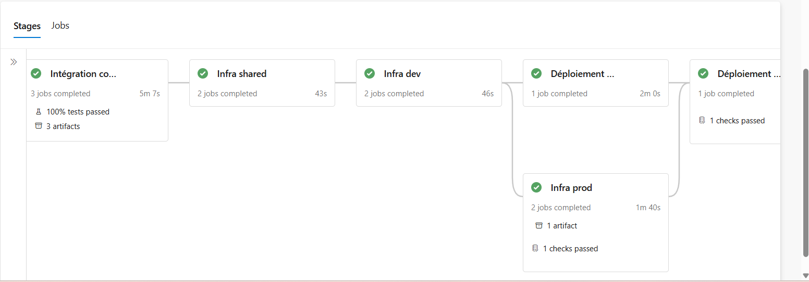

## Sommaire

1. [Architecture](#architecture)
2. [Le pipeline](#le-pipeline)
3. [Choix techniques](#choix-techniques)
4. [Sécurité](#sécurité)
5. [Problèmes rencontrés et solutions](#problèmes-rencontrés-et-solutions)
6. [Supervision](#supervision)
7. [Coûts](#coûts)
8. [Reproduire le projet](#reproduire-le-projet)
9. [Pistes d'amélioration](#pistes-damélioration)

## Architecture

Région Azure : `francecentral`.

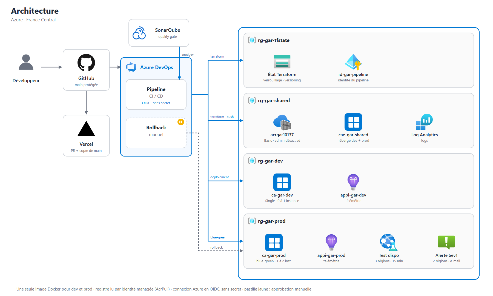

<details>
<summary>Version texte du schéma d'architecture (Mermaid)</summary>

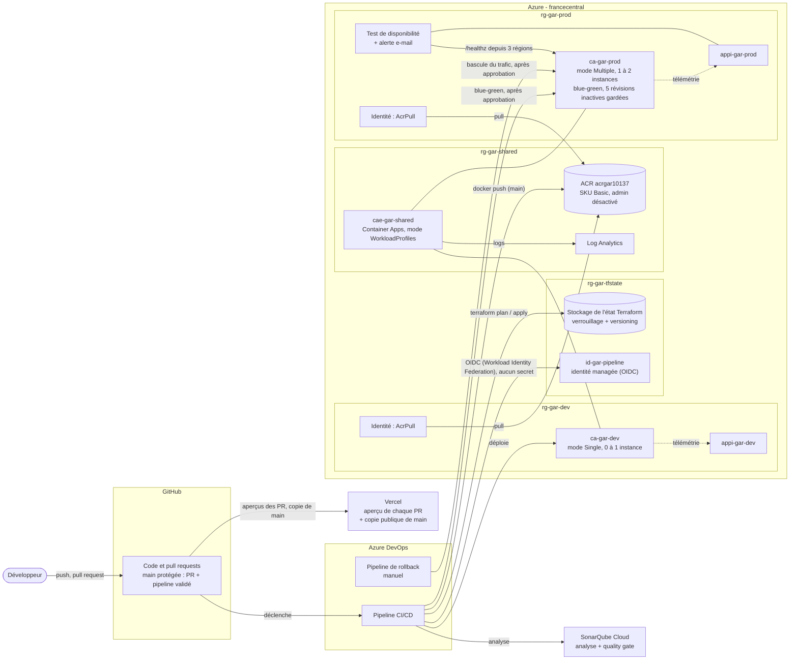

</details>

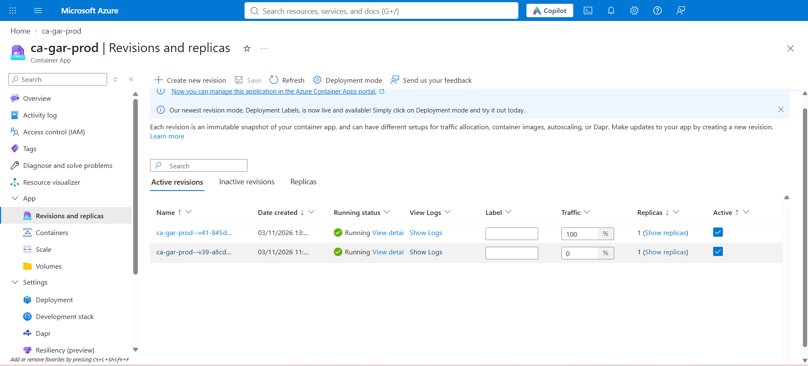

| Groupe de ressources | Contenu | Géré par |
|---|---|---|
| `rg-gar-tfstate` | État Terraform, identité du pipeline `id-gar-pipeline` | Création manuelle (bootstrap) |
| `rg-gar-shared` | Registre ACR, Log Analytics, environnement Container Apps `cae-gar-shared` | Terraform (`infra/environments/shared`) |
| `rg-gar-dev` | `ca-gar-dev`, `appi-gar-dev`, identité AcrPull | Terraform (`infra/environments/dev`) |
| `rg-gar-prod` | `ca-gar-prod`, `appi-gar-prod`, identité AcrPull, test de disponibilité, alerte | Terraform (`infra/environments/prod`) |

Chaque environnement dev et prod possède aussi son propre espace Log Analytics (`law-gar-dev`, `law-gar-prod`) qui reçoit les données de son Application Insights.

Vercel déploie un aperçu de chaque pull request, ainsi qu'une copie publique de la branche `main` ; la production de référence est sur Azure Container Apps.

## Le pipeline

Le pipeline principal est dans [pipelines/azure-pipelines.yml](pipelines/azure-pipelines.yml), le plan/apply Terraform dans [pipelines/templates/terraform.yml](pipelines/templates/terraform.yml), le rollback dans [pipelines/rollback.yml](pipelines/rollback.yml).

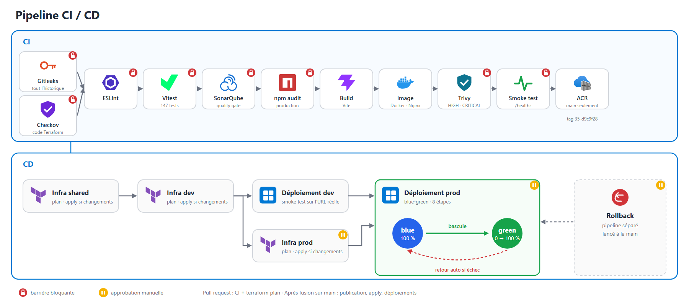

<details>
<summary>Version texte du schéma du pipeline (Mermaid)</summary>

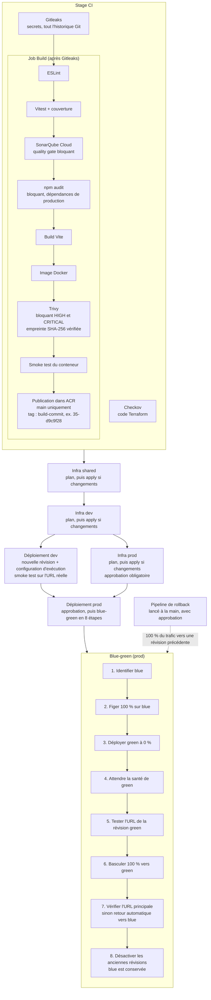

</details>

Dans le stage CI, Checkov s'exécute en parallèle du job Build ; Gitleaks doit réussir avant le Build. Les stages d'infrastructure attendent la fin de tout le stage CI.

### Pull request ou fusion sur main

| Étape | Pull request | Après fusion sur `main` |
|---|---|---|
| Gitleaks, Checkov | oui | oui |
| ESLint, tests Vitest, couverture | oui | oui |
| SonarQube Cloud, quality gate bloquant | oui | oui |
| `npm audit` (production), build | oui | oui |
| Image Docker, Trivy, smoke test | oui | oui |
| Publication de l'image dans ACR | non | oui |
| `terraform plan` (shared, dev, prod) | oui | oui |
| `terraform apply` | non | oui, seulement s'il y a des changements ; approbation pour la prod |
| Déploiement dev | non | oui, automatique |
| Déploiement prod (blue-green) | non | oui, après approbation |
| Déploiement Vercel | aperçu de la pull request | copie publique de `main` |
| Rollback | non | à la demande (pipeline séparé, avec approbation) |

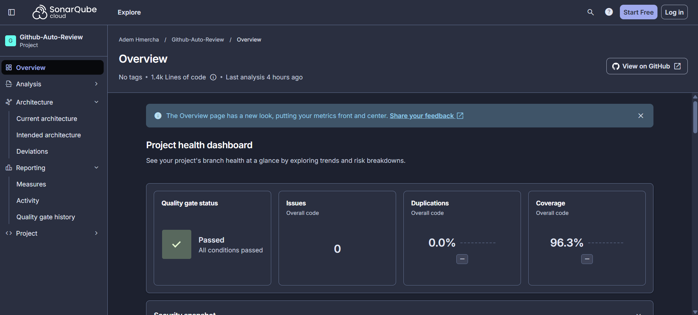

## Choix techniques

- **Container Apps plutôt qu'AKS.** Container Apps est basé sur Kubernetes mais sans cluster à administrer ; il coûte une fraction d'AKS et correspond au besoin (une application web, des révisions, du trafic réparti). AKS est listé dans les pistes d'amélioration.
- **OIDC sans secret et droits minimaux.** Le pipeline se connecte à Azure par Workload Identity Federation : aucun mot de passe ni clé n'est stocké. Le registre n'a pas de compte admin ; chaque application lit les images avec sa propre identité managée, qui n'a que le rôle `AcrPull`.
- **Build once, deploy many et configuration au démarrage (Twelve-Factor).** La même image part en dev et en prod. La chaîne de connexion Application Insights est lue dans Azure par le pipeline au déploiement et passée au conteneur comme variable d'environnement `APPINSIGHTS_CONNECTION_STRING`. Au démarrage, le mécanisme de templates de l'image Nginx officielle (`/etc/nginx/templates`, traité par `envsubst`) la sert dans `/config.js`, que le navigateur charge avant l'application.
- **Parité des environnements.** Dev et prod utilisent les mêmes modules Terraform (`container_app`, `monitoring`) ; seuls les fichiers `terraform.tfvars` changent (instances, mode de révision, test de disponibilité).
- **Plateforme partagée.** Un seul environnement Container Apps (`cae-gar-shared`) et un seul registre sont partagés par dev et prod, à cause d'une limite de l'abonnement (voir [Problèmes rencontrés](#problèmes-rencontrés-et-solutions)). L'image est ainsi construite une fois, puis promue.
- **Répartition des rôles.** Terraform crée l'infrastructure ; le pipeline gère les versions. Le module `container_app` déclare donc `ignore_changes` sur l'image, les variables d'environnement, le suffixe de révision et la répartition du trafic, pour que Terraform n'annule pas un déploiement.

## Sécurité

### Barrières du pipeline

| Outil | Ce qu'il protège | Ce qu'il a réellement trouvé |
|---|---|---|
| Gitleaks (historique complet) | Secrets dans le code et dans les anciens commits | Une fausse clé Groq écrite dans deux fichiers de test (`src/App.test.jsx`, `src/components/InputForm.test.jsx`), arrivée dans l'historique au commit `571d0e6` et bloquée par Gitleaks dans le pipeline. Corrigé en construisant la clé à l'exécution ; les deux empreintes de ce commit sont listées dans `.gitleaksignore` pour que l'historique repasse au vert |
| Checkov | Mauvaises pratiques dans le code Terraform | Réglages du registre ACR : 8 exceptions documentées dans le code (voir ci-dessous) |
| ESLint | Erreurs et mauvaises pratiques JavaScript | Le script `lint` n'existait pas : l'étape `--if-present` ne faisait rien. Corrigé, puis 8 erreurs réelles au premier passage |
| SonarQube Cloud (gate bloquant) | Qualité, sécurité et couverture du nouveau code | Couverture du nouveau code à 29,4 % (80 % requis), et une écriture de valeur non validée dans `localStorage` |
| `npm audit` | Vulnérabilités des dépendances livrées | Aucune vulnérabilité de production à ce jour |
| Trivy (image) | CVE dans l'image Docker | 10 CVE dans Nginx 1.28.2, dont 1 critique |

Résultats SonarQube Cloud : notes A en sécurité, fiabilité et maintenabilité, 0 % de duplication. Tests : 147 tests Vitest.

### Exceptions Checkov (registre ACR)

Le registre est en SKU Basic, adapté à un crédit étudiant. Huit contrôles sont ignorés, chacun avec sa justification dans [infra/environments/shared/main.tf](infra/environments/shared/main.tf) :

| Contrôle | Raison |
|---|---|
| CKV_AZURE_139 | L'accès public est requis par les agents hébergés d'Azure Pipelines ; le désactiver impose le SKU Premium avec des endpoints privés. L'accès reste authentifié (Entra ID), compte admin désactivé |
| CKV_AZURE_163 | Risque couvert : chaque image est scannée par Trivy avant publication |
| CKV_AZURE_166 | Risque couvert : seules des images déjà scannées sont publiées |
| CKV_AZURE_164 | Content trust réservé au SKU Premium ; la signature des images est une évolution prévue |
| CKV_AZURE_167 | Politique de rétention réservée au SKU Premium |
| CKV_AZURE_233 | Redondance de zone réservée au SKU Premium |
| CKV_AZURE_237 | Points de terminaison de données dédiés réservés au SKU Premium |
| CKV_AZURE_165 | Sans objet : application déployée dans une seule région |

### Autres mesures

- Conteneur non root (UID 101, image `nginx-unprivileged`), port 8080.
- HTTPS uniquement : `allow_insecure_connections = false` sur l'ingress.
- En-têtes de sécurité Nginx : `X-Content-Type-Options`, `X-Frame-Options: DENY`, `Referrer-Policy`.
- Aucun secret dans le dépôt : connexion à Azure en OIDC, e-mail d'alerte fourni par la variable de pipeline `alertEmail`, chaîne de connexion Application Insights lue dans Azure au déploiement.
- Cookies de télémétrie désactivés (`disableCookiesUsage: true`).
- Versions des outils de sécurité épinglées (Terraform, Gitleaks, Trivy, Checkov) ; l'archive de Trivy est vérifiée par empreinte SHA-256 avant usage.
- Clé Groq : saisie dans le navigateur, validée par un motif strict avant d'être enregistrée localement ; elle n'est jamais envoyée à un serveur du projet.

## Problèmes rencontrés et solutions

**Abonnement étudiant limité à 5 régions.** *Contexte :* la première création de ressource dans `swedencentral` aurait été refusée : l'abonnement Azure for Students porte une stratégie « Allowed resource deployment regions » qui n'autorise que 5 régions. *Diagnostic :* `az policy assignment list`. *Solution :* `francecentral` pour toutes les ressources, et une règle de validation dans les variables Terraform (`location`) qui refuse toute région non autorisée avant même de contacter Azure. *Leçon :* vérifier les politiques d'un abonnement avant de concevoir l'infrastructure.

**Erreur trompeuse « SubscriptionNotFound ».** *Contexte :* Terraform affichait que l'abonnement n'existait pas, alors qu'il était bien là. *Diagnostic :* des fournisseurs de ressources (`Microsoft.Storage`, `Microsoft.ManagedIdentity`...) n'étaient pas enregistrés. *Solution :* les enregistrer à la main ; le provider est configuré avec `resource_provider_registrations = "none"`. *Leçon :* un message d'erreur Azure peut désigner la mauvaise cause.

**Environnements Container Apps créés en mode Express.** *Contexte :* le blue-green est impossible sans révisions multiples ni répartition du trafic. *Diagnostic :* Azure crée désormais les environnements en mode Express, qui ne les permet pas. *Solution :* convertir l'environnement en mode WorkloadProfiles avec le provider `azapi` (`azapi_resource_action`, PATCH `environmentMode`), le provider `azurerm` ne gérant pas encore ce réglage. *Leçon :* un provider peut avoir du retard sur l'API ; `azapi` comble l'écart.

**Un seul environnement Container Apps (hors Express) par abonnement.** *Contexte :* un environnement par application (dev, prod) dépassait la limite. *Solution :* une plateforme partagée (`rg-gar-shared`) où dev et prod déploient chacun leur application. *Leçon :* une contrainte de quota peut dicter l'architecture ; ici elle a aussi simplifié la promotion d'une même image.

**Cohérence à terme d'Azure.** *Contexte :* juste après sa création, un espace Log Analytics était introuvable (erreur 404) pour la ressource qui en dépendait. Plus tard, un environnement Container Apps créé avec succès a été déclaré « present, but now absent » par Terraform, qui ne l'a donc pas enregistré dans son état. *Solution :* relancer après quelques minutes dans le premier cas ; dans le second, vérifier l'existence réelle de la ressource avec une version récente de l'API, puis la reprendre en main avec `terraform import`. *Leçon :* dans le cloud, une ressource créée n'est pas toujours visible immédiatement, et l'état Terraform doit être réconcilié avec la réalité.

**Groupe d'actions « Smart Detection » créé en coulisse.** *Contexte :* la suppression d'un groupe de ressources était bloquée. *Diagnostic :* Application Insights crée automatiquement un groupe d'actions « Smart Detection » dans le groupe. *Solution :* le supprimer avant le groupe de ressources. *Leçon :* Azure crée parfois des ressources qu'on n'a pas déclarées ; il faut les connaître avant de détruire.

**Attaque de la chaîne d'approvisionnement de Trivy (2026).** *Contexte :* des releases de Trivy ont été supprimées et la version 0.69.4 était piégée. *Diagnostic :* la vérification d'empreinte SHA-256 du pipeline a refusé l'installation. *Solution :* version épinglée sur la 0.69.3, publiée en release immuable. Règle adoptée : ne pas utiliser une version d'outil publiée depuis moins de deux semaines (exemple : Checkov 3.3.30 plutôt que 3.4.0). *Leçon :* un outil de sécurité est lui-même une dépendance à vérifier.

**10 CVE dans Nginx 1.28.2, dont 1 critique (exécution de code à distance).** *Contexte :* Trivy a bloqué l'image. *Diagnostic :* Nginx vient du dépôt nginx.org et n'est pas mis à jour par `apk`. *Solution :* passage à la branche mainline 1.31, plus `apk upgrade` pour les bibliothèques Alpine ; Node 20, en fin de vie, remplacé par Node 24 LTS. *Leçon :* « mettre à jour les paquets du système » ne couvre pas un logiciel installé depuis une autre source.

**Quality gate SonarQube Cloud qui ne bloquait pas.** *Contexte :* le tableau de bord SonarQube Cloud affichait un échec, mais le pipeline passait. *Diagnostic :* en comparant les deux, l'option `sonar.qualitygate.wait` manquait. *Solution :* l'ajouter (`sonar.qualitygate.wait=true` dans [pipelines/azure-pipelines.yml](pipelines/azure-pipelines.yml)). *Leçon :* un contrôle qui ne bloque pas donne une fausse impression de sécurité ; il faut tester qu'une barrière peut échouer.

**Dérives Terraform causées par Azure ou par le pipeline.** *Contexte :* `terraform plan` proposait des changements alors que rien n'avait été modifié. *Diagnostic :* Azure ajoute un profil de charge (`workload_profile`) et un tag `hidden-link` ; le pipeline change le suffixe de révision et les variables d'environnement. *Solution :* déclarer explicitement les attributs ajoutés par Azure, et ignorer ceux que le pipeline gère (`ignore_changes`). *Leçon :* un plan propre à vide est la condition pour que l'apply automatique reste sûr.

**Révisions perdues (`max_inactive_revisions` à 0).** *Contexte :* après un déploiement, les anciennes révisions disparaissaient. *Diagnostic :* le paramètre valait 0, donc aucune révision inactive n'était conservée. *Solution :* le passer à 5, pour garder un historique de rollback. *Leçon :* le rollback dépend de ce qu'on conserve.

**Jeton SonarQube exposé.** *Contexte :* lors de la configuration de SonarQube Cloud, le jeton d'accès a été partagé par erreur en dehors du coffre prévu. *Solution :* il a été considéré comme compromis, révoqué immédiatement et remplacé par un nouveau jeton, stocké uniquement dans la service connection Azure DevOps. *Leçon :* un secret qui sort de son coffre doit être révoqué, même si l'endroit semble sûr ; révoquer d'abord, remplacer ensuite.

## Supervision

- **Télémétrie navigateur** (Application Insights) : pages vues, erreurs JavaScript, performances. Temps de chargement mesuré : environ 740 ms. Initialisée dans [src/lib/telemetry.js](src/lib/telemetry.js) à partir de `/config.js` ; sans configuration, elle ne fait rien et ne bloque jamais l'application.
- **Test de disponibilité** : test web standard sur `/healthz`, toutes les 15 minutes depuis 3 régions (France Central, North Europe, West Europe). Temps de réponse moyen : environ 100 ms.
- **Alerte** : sévérité 1, déclenchée si au moins 2 régions échouent, résolution automatique, notification par e-mail.

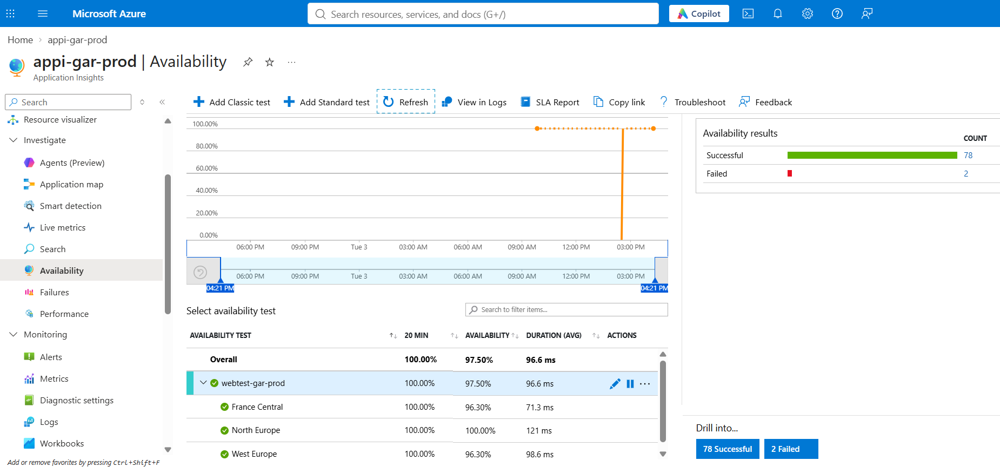

Exemple de requête KQL (Application Insights, temps de chargement des pages) :

```kusto
pageViews
| where timestamp > ago(24h)
| summarize pages = count(), chargement_moyen_ms = avg(duration) by bin(timestamp, 1h)
| order by timestamp asc
```

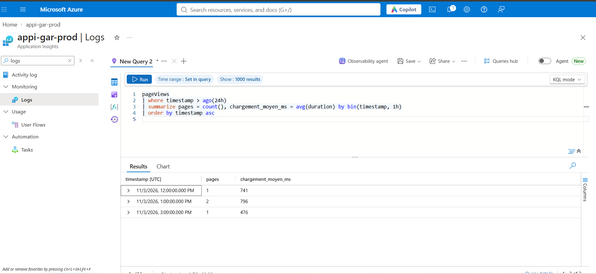

### Rapport d'exercice de panne (3 novembre 2026)

Une panne a été simulée en restreignant l'accès par adresse IP à l'application (erreur 403 pour les tests de disponibilité). Heures de Tunisie (UTC+1) :

| Événement | Heure |
|---|---|
| Début de la panne simulée (restriction d'accès IP, erreur 403) | vers 14 h 30 |
| Premier échec détecté (France Central) | 14 h 33 |
| Deuxième région en échec (West Europe), e-mail d'alerte (Fired) | 14 h 36 |
| Rétablissement du site | vers 14 h 48 |
| E-mail de résolution automatique (Resolved) | 14 h 51 |

Délai de détection : environ 6 minutes.

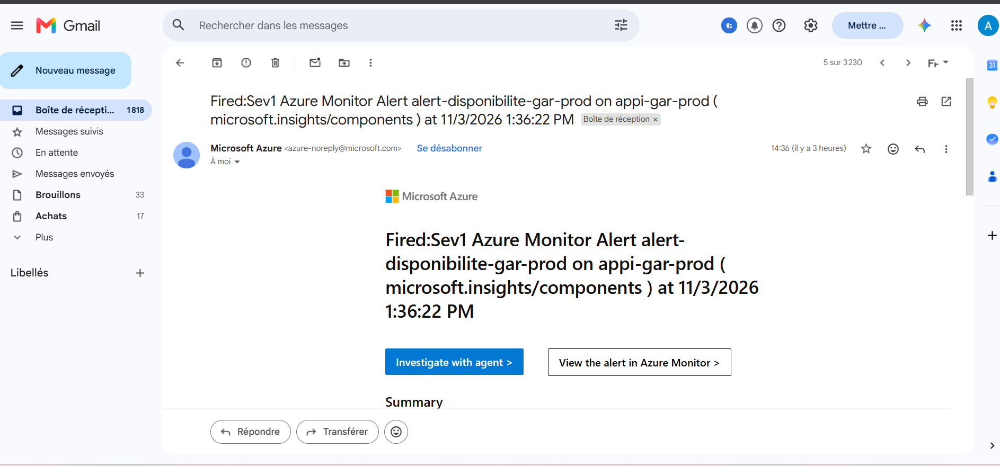
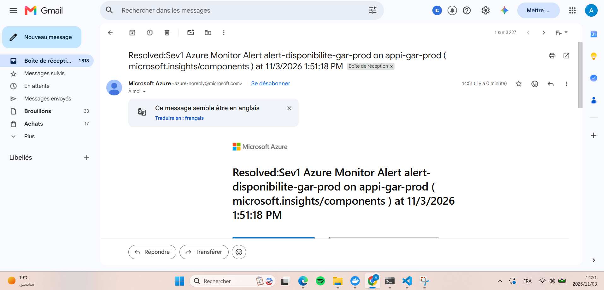

**Compromis coût et délai de détection.** Chaque exécution du test est facturée, par région. Avec un test toutes les 15 minutes, le délai de détection dépend du moment de la panne : il peut aller de quelques minutes à 15, voire 30 minutes. Un test toutes les 5 minutes réduirait ce délai mais triplerait le coût du test.

**Pourquoi 2 régions sur 3.** Un échec isolé d'une seule région est souvent un incident réseau local au point de test, pas une panne de l'application. Exiger 2 régions limite les fausses alertes.

**Durée de la panne et durée de l'alerte.** La panne vue par un utilisateur va du début de la restriction (vers 14 h 30) au rétablissement (vers 14 h 48), soit environ 18 minutes. L'alerte, elle, a été ouverte de 14 h 36 à 14 h 51 : elle s'ouvre après la détection et ne se ferme qu'une fois que les tests réussis sont constatés, d'où un décalage avec la durée réelle de la panne.

## Coûts

Estimations mensuelles, dans un crédit étudiant de 100 $ :

| Poste | Coût estimé |
|---|---|
| Registre ACR Basic | environ 5 $ |
| Prod toujours allumée (1 instance minimum) et sa révision blue gardée active | quelques dollars |
| Test de disponibilité (3 régions, toutes les 15 minutes) | environ 4 $ |
| Dev | quasi gratuit : il s'éteint (0 instance) quand il n'est pas utilisé |
| Outils de sécurité (Gitleaks, Checkov, Trivy, SonarQube Cloud, npm audit) | gratuits |

Compromis faits pour tenir dans le budget : registre en SKU Basic (d'où les exceptions Checkov), un seul environnement Container Apps partagé, dev qui s'éteint, test de disponibilité uniquement sur la prod et à la fréquence la plus basse (15 minutes), rétention des logs de 30 jours, Container Apps en plan Consumption (facturé à l'usage).

## Reproduire le projet

### Prérequis

- Un abonnement Azure et Azure CLI, Terraform 1.16.x (`>= 1.9` accepté par le code), Node.js 24, Docker.
- Une organisation et un projet Azure DevOps, un projet SonarQube Cloud.
- Fournisseurs de ressources enregistrés dans l'abonnement, notamment `Microsoft.Storage` et `Microsoft.ManagedIdentity` (voir [Problèmes rencontrés](#problèmes-rencontrés-et-solutions)) ; vérifier aussi ceux des services utilisés (Container Apps, Log Analytics, Application Insights, registre).

### Bootstrap (à la main, une seule fois)

1. Créer le groupe `rg-gar-tfstate` et un compte de stockage avec un conteneur `tfstate` (versioning activé). Reporter le nom du compte dans les blocs `backend "azurerm"` et `terraform_remote_state` de `infra/environments/*`.
2. Créer l'identité managée du pipeline `id-gar-pipeline` avec les droits nécessaires sur l'abonnement.
3. Dans Azure DevOps, créer la service connection `sc-azure-gar` (Azure Resource Manager, Workload Identity Federation) et la connexion `sc-sonarcloud`.
4. Adapter `suffix` (`infra/environments/shared/terraform.tfvars`) : le nom du registre doit être unique dans Azure.

### Ordre d'application

Le pipeline applique dans l'ordre `shared`, puis `dev`, puis `prod` (chacun lit l'état de `shared`). En local, la même séquence :

```bash
cd infra/environments/shared && terraform init && terraform apply
cd ../dev                    && terraform init && terraform apply
cd ../prod                   && terraform init && terraform apply
```

### Configuration Azure DevOps

- Environnements à créer : `infra-shared`, `infra-dev`, `infra-prod`, `app-dev`, `app-prod`. Ajouter une approbation sur `infra-prod` et `app-prod`.
- Variable de pipeline `alertEmail` : adresse qui reçoit les alertes (non écrite dans le dépôt).
- Pipeline de rollback : créer un second pipeline sur [pipelines/rollback.yml](pipelines/rollback.yml).

### Lancer l'application en local

```bash
npm ci
npm run dev        # http://localhost:5173
npm run lint
npm run test:coverage
```

Image Docker :

```bash
docker build -f docker/Dockerfile -t gar:local .
docker run --rm -p 8080:8080 -e APPINSIGHTS_CONNECTION_STRING="" gar:local
```

## Pistes d'amélioration

- Signature des images (Content trust en Premium, ou Cosign dans le pipeline).
- Mises à jour automatiques des dépendances (Dependabot ou Renovate).
- Endpoints privés pour le registre (SKU Premium).
- Environnement de staging entre dev et prod.
- Droit User Access Administrator limité par condition pour l'identité du pipeline.
- Passage des tâches SonarCloud en version 4.
- Démonstration Kubernetes (AKS éphémère).
